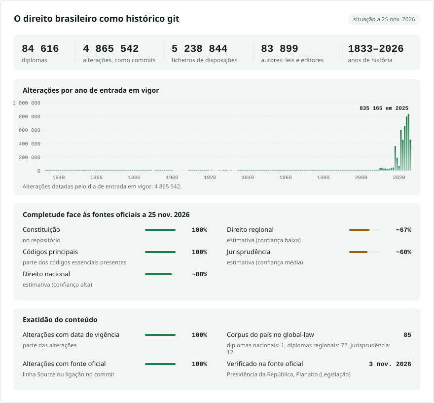

# Brasil: o histórico da legislação em git

**Português** · [English](README.en.md)

<picture>
<source media="(prefers-color-scheme: dark)" srcset="data/pt/effort-dark.svg">

</picture>

O direito do Brasil como um histórico git: um arquivo por artigo, um commit por versão no dia em que entrou em vigor e, como autor do commit, o ato que fez cada alteração. `git blame` mostra o ato por trás de cada parágrafo; `git log` lista todas as alterações de um artigo; escolhendo uma data, obtém-se o texto vigente nesse dia.

Faz parte de [lexifina/global-law](https://github.com/lexifina/global-law), um único histórico git da legislação de todos os países: este é o direito federal do Brasil, que o global-law lê em `brazil/national/acts/`.

**O que contém hoje:** a Constituição e 323 códigos e leis federais com seu histórico, a partir de 1851; 15.400 leis federais ao todo com o texto vigente (`federal/`); o texto publicado no Diário Oficial de 32.072 normas federais (`federal/textos-originais/`); 29.928 atos normativos e decisões do CMN, do Banco Central, da CVM, da Receita Federal e da ANATEL (`reguladores/`); 28.949 atos estaduais de 18 estados (`estados/`); e 4,8 milhões de decisões judiciais do STF, do STJ, do TST, do TJDFT, do TRF2, do TRF4, do TRF6, do TJPR, do TJSP e, pelo espelho RepoJus, do TJES e do TJMT (`tribunais/`). Das 29.407 leis federais numeradas do catálogo do Senado, 25.738 (88%) estão no repositório com o seu texto. A coleta foi pausada em 25 de novembro de 2026. A pasta de cada ato tem um `README.md` que lista seus dispositivos, quantas vezes cada um foi alterado e quando. No GitHub, o histórico de um arquivo para na mudança de 24 de novembro de 2026: use o histórico completo no `README.md` de cada ato ou `git log --follow`.

**Deixado de fora quando a coleta foi pausada, em 25 de novembro de 2026:**

- 3.669 leis federais numeradas ainda não incluídas, cerca de 3.450 delas porque o normas.leg.br não tem texto original legível; as redações anteriores dos atos que só têm o texto atual; os 165.359 decretos numerados;
- decisões judiciais que trazem o CPF de uma pessoa, retidas sem publicar (cerca de 248.000 no espelho RepoJus); cerca de 251.000 decisões do STF cujo texto está atrás de uma página de verificação; os dias do Diário do STJ de 5 de novembro de 2019 a 31 de dezembro de 2020, que não estão em nenhum dos seus conjuntos de dados abertos;
- a legislação da Bahia, de Goiás, do Tocantins e do Rio Grande do Norte e as decisões do TJSC, coletadas mas não verificadas, portanto não publicadas; Rio de Janeiro, Santa Catarina, Rio Grande do Sul, Espírito Santo, Amapá, Maranhão, Roraima e Mato Grosso, cujos sites recusaram ou bloquearam o acesso;
- o Diário Oficial da União, a ANEEL e o Saúde Legis (ANVISA), que responderam com erros ou páginas de bloqueio.

Cada ato é uma pasta com o seu nome em `federal/<tipo>/`, com um arquivo por artigo (`federal/codigos-e-estatutos/clt/art-134.md` é o art. 134 da Consolidação das Leis do Trabalho, Decreto-Lei 5.452/1943; `federal/leis/2001/lei-10334-de-2001/` é a Lei 10.334/2001; [`data/paths.json`](data/paths.json) indica onde cada ato estava antes da mudança de 24 de novembro de 2026); a Constituição está em [`constituicao/`](constituicao/), com os artigos do ADCT como `adct-art-<n>.md`.

O texto está em português, tal como o Planalto o publica. Uma tradução para o inglês não faz parte deste registro.

## Perguntas como comandos git

| Pergunta | Comando |
| --- | --- |
| Todas as alterações do art. 134 da CLT (férias) | `git log --follow -p --word-diff -- federal/codigos-e-estatutos/clt/art-134.md` |
| Que ato escreveu cada parágrafo do art. 134? | `git blame federal/codigos-e-estatutos/clt/art-134.md` |
| Todas as versões da CLT, com o dia em que cada uma entrou em vigor | `git log --format="%h %(trailers:key=In-force,valueonly,separator=) %an" -- federal/codigos-e-estatutos/clt clt ':(exclude)*/README.md'` |
| O art. 134 vigente em 1º de janeiro de 2015 | `python tools/vigente_em.py 2015-01-01 clt 134` |

**Fora do git**, também disponibilizamos este registro publicamente, de graça:

- **[Pergunte ao Claude sobre o direito brasileiro](https://global-law.lexifina.com/v1/try_claude?country=brazil)**: abre o Claude com uma primeira pergunta já pronta.
- **[Pergunte ao ChatGPT](https://global-law.lexifina.com/v1/try_chatgpt?country=brazil)**: a mesma pergunta no ChatGPT.
- **[Pesquise o direito brasileiro no nosso site](https://lexifina.com/law?country=brazil&q=f%C3%A9rias)**: uma busca por "férias", com o texto de cada dispositivo e suas versões, sem precisar de conta.
- **[API REST para desenvolvedores](https://global-law.lexifina.com/v1/search_law?query=f%C3%A9rias&jurisdiction=brazil)**: a mesma busca em JSON, sem chave. Veja a [documentação aqui](https://lexifina.com/api/global-law).

Os dois assistentes leem o registro pelo conector gratuito Global law (MCP, `https://global-law.lexifina.com/mcp`); na primeira vez, o chat fornece o link que o adiciona. Pergunte em português ou em inglês.

**Hospede você mesmo, com facilidade.** Basta ter git e Python, e as ferramentas rodam na sua máquina:

```sh
git clone --depth 1 https://github.com/lexifina/global-law && cd global-law
python3 tools/countries.py add brazil/national/acts
python3 tools/law.py show 2026-01-01 brazil/national/acts/federal/codigos-e-estatutos/clt/art-134.md
```

Aberto no Claude Code, no Cursor, no VS Code ou no Codex, o clone também inicia um servidor MCP local com as mesmas ferramentas ([MCP.md](https://github.com/lexifina/global-law/blob/main/MCP.md)).

## Datas

Cada commit tem como data o meio-dia, no fuso America/Sao_Paulo, do dia em que a versão entrou em vigor, e a registra no trailer `In-force:`, ao lado de `Enacted:` e `Published:`:

- o dia que a cláusula de vigência do próprio ato alterador indica (na data da publicação, na da promulgação, em um dia fixo ou dispositivo por dispositivo), ou o dia posterior que ela fixa para um dispositivo produzir efeitos; sem cláusula, o art. 1º da LINDB: 45 dias depois da publicação oficial, contados segundo o art. 8º, § 1º, da LC 95/1998;
- uma Medida Provisória, a partir da sua publicação; quando ela perde a eficácia ou é rejeitada, segue-se um commit que restaura a redação anterior, datado pelo registro do Congresso;
- para os 5.000 atos somente com o texto atual, o dia de entrada em vigor da alteração mais recente que esse texto mostra;
- o git não armazena datas anteriores a 1970, por isso os 235 commits mais antigos têm datas a partir de 1970-01-01, com um segundo de intervalo, e o dia real em `In-force:`. Consulte uma data com `tools/vigente_em.py`, não com `git log --before`.

Cada alteração é atribuída ao ato que a nota do Planalto ao lado dela indica ("Redação dada pela Lei nº 13.467, de 2017"), com um endereço que não pode existir (`lei-13467-2017@planalto.invalid`); as decisões do Supremo Tribunal Federal que o Planalto mostra como palavras riscadas são commits do tipo `court`. A versão única de cada ato só com o texto atual é atribuída ao Planalto, como a versão mais antiga disponível. O branch `futuro` também guarda o que já foi promulgado mas ainda não está em vigor, como o art. 7º, XV, da EC 141/2026 (16 de dezembro de 2026) e as etapas da reforma tributária da EC 132/2023 de 2027 e 2033.

## Como é verificado

- `tools/check_repo.py` lê de volta do git cada uma das 9.366 versões no dia em que entrou em vigor e no dia anterior, e a compara com o corpus: 0 divergências. Os resultados estão em [`REPRODUCE.md`](REPRODUCE.md).
- O texto vigente hoje da Constituição e dos códigos é comparado com a página compilada do Planalto, unidade por unidade. Na Constituição, 392 de 414 unidades eram idênticas em 28 de outubro de 2026, e as outras 22 só diferem onde as duas páginas do Planalto têm composição tipográfica diferente; todas as diferenças estão listadas em `REPRODUCE.md`.
- Nenhum commit de merge no `main`, nenhuma data de commit que volte para trás, nada datado depois do build, e os trailers de todos os commits são legíveis.
- O histórico só recebe acréscimos: novos atos e versões são adicionados por cima (`tools/append.py`), e nenhum commit publicado é reescrito.
- [vulnerabilities/](vulnerabilities/): possíveis erros de técnica legislativa no direito brasileiro, encontrados pelos detectores do global-law e verificados à mão.

## O que não mostra

- **Redações anteriores de 5.000 atos.** Eles têm somente o texto atual; seu histórico será adicionado depois, como correções identificadas.
- **Outros atos federais.** Nenhum decreto (além dos que estão entre os textos originais), e as Medidas Provisórias somente como as alterações que fizeram e como textos originais. 3.669 leis federais numeradas do catálogo do Senado não estão no repositório (na maioria Decretos-Leis de 1937-1946 e leis orçamentárias). Jurisprudência: o STF, o STJ, o TST, o TJDFT, o TRF2, o TRF4, o TRF6, o TJPR e o TJSP, e outros tribunais só onde o espelho RepoJus os tem; nada do TSE nem do STM. A coleta foi pausada em 25 de novembro de 2026.
- **Redações que a fonte não data.** Na CLT, 60 linhas riscadas sem nota ficam fora de todas as versões; na Lei 8.112/1990, faltam os períodos das Medidas Provisórias 301/2006, 341/2006 e 359/2007, cuja redação o Planalto não publica.
- **Efeitos que não mudam nenhuma palavra**: as interpretações do STF ("Vide ADI") e os efeitos apenas financeiros, retroativos ou deixados para um ato posterior.
- **Assinaturas, as notas do Planalto** (usadas só para datar e atribuir as alterações) e alguns anexos, como a tabela de taxas do Estatuto do Desarmamento.

## Fontes

| Fonte | Tipo | Versões anteriores | Notas |
| --- | --- | --- | --- |
| [Planalto (Legislação)](https://www.planalto.gov.br/ccivil_03/) (Presidência da República, Casa Civil) | Legislação oficial | em parte: a redação substituída é mantida, riscada, com uma nota que indica o ato alterador | A página de cada ato (anotada, e compilada quando o Planalto tem uma) e a página de cada ato que suas notas citam, lidas por meio de cópias datadas do Internet Archive; o texto oficial é o publicado no Diário Oficial da União |
| [Supremo Tribunal Federal](https://portal.stf.jus.br/) | Tribunal | não se aplica | Páginas dos processos das decisões que riscaram palavras, para a decisão e o dia em que foi publicada |
| [LexML Brasil](https://www.lexml.gov.br) (Senado Federal) | Registros legislativos | não | O dia da "Publicação Original" no Diário Oficial de cada lei citada |
| [Câmara dos Deputados, Legislação Informatizada](https://www2.camara.leg.br/legin/fed/) | Parlamento | não | Somente dados de publicação (retificações, um Ato Declaratório) |
| [normas.leg.br](https://normas.leg.br/) (Congresso Nacional) | Registros legislativos, CC BY 4.0 | sim: as versões de cada dispositivo | Desde novembro de 2026: as versões da LC 214/2025 e o texto de cada norma federal tal como publicado no Diário Oficial da União (`federal/textos-originais/`) |
| [Banco Central do Brasil, Busca de normas](https://www.bcb.gov.br/estabilidadefinanceira/buscanormas) | Regulador | não (o texto vigente) | Desde novembro de 2026: resoluções do Conselho Monetário Nacional e resoluções, circulares e instruções do BCB (`reguladores/`) |
| [Senado Federal, Dados Abertos (SIGEN)](https://legis.senado.leg.br/dadosabertos/) | Registros legislativos | não | O catálogo das normas federais (a contagem de leis acima) e suas alterações |
| [Superior Tribunal de Justiça, Dados Abertos](https://dadosabertos.web.stj.jus.br/) | Tribunal, CC BY | não se aplica | Acórdãos e decisões terminativas (`tribunais/stj/`) |
| [Supremo Tribunal Federal, jurisprudência](https://jurisprudencia.stf.jus.br/) | Tribunal | não se aplica | Acórdãos e decisões (`tribunais/stf/`) |
| [Tribunal Superior do Trabalho, jurisprudência](https://jurisprudencia.tst.jus.br/) | Tribunal | não se aplica | Acórdãos, a partir dos PDFs do próprio tribunal (`tribunais/tst/`) |
| [TJDFT, JurisDF](https://jurisdf.tjdft.jus.br/) | Tribunal | não se aplica | Acórdãos (`tribunais/tjdft/`) |
| [RepoJus](https://huggingface.co/datasets/andrebadini/repojus) (André Badini) | Conjunto de dados, CC BY 4.0 | não se aplica | Espelho com crédito, só para tribunais sem fonte oficial aqui |
| [TRF2](https://eproc.trf2.jus.br/), [TRF4](https://jurisprudencia.trf4.jus.br/), [TRF6](https://eproc2g.trf6.jus.br/) (pesquisa de jurisprudência do eproc) | Tribunais | não se aplica | Acórdãos (`tribunais/trf2/`, `trf4/`, `trf6/`) |
| [TJPR](https://portal.tjpr.jus.br/jurisprudencia/), [TJSP](https://eproc1g.tjsp.jus.br/) (eproc) | Tribunais | não se aplica | Acórdãos (`tribunais/tjpr/`, `tribunais/tjsp/`) |
| [CVM](https://conteudo.cvm.gov.br/legislacao/), [Receita Federal, SIJUT2](https://normas.receita.fazenda.gov.br/), [ANATEL](https://informacoes.anatel.gov.br/legislacao/) | Reguladores | não (o texto vigente) | Atos normativos; as Soluções de Consulta da Receita como documentos (`reguladores/`) |
| Assembleias Legislativas e Casas Civis (SAPL do AC, AL, AM, PB, PI, RO; ALEPE; ALMG; Legisla-e; repositórios estaduais anteriores da Lexifina) | Legislação estadual | conforme cada fonte | `estados/<estado>/` |

## Licença

Veja [`LICENSE`](LICENSE). Os textos são atos oficiais do Brasil tal como a Presidência da República (Casa Civil) os publica em planalto.gov.br, e os atos oficiais não são protegidos por direito autoral no Brasil (Lei 9.610/1998, art. 8º, IV); a organização do histórico, as mensagens de commit, as tabelas e as ferramentas estão sob CC0 1.0.

Nenhum modelo de IA escreveu, traduziu ou alterou texto legal, e nenhum é executado quando o histórico é gerado; os scripts, e as tabelas de datas de vigência que eles contêm, foram escritos por um modelo de IA a partir das páginas oficiais (veja [`REPRODUCE.md`](REPRODUCE.md)).

Esta é uma tradução da versão inglesa ([README.en.md](README.en.md)); em caso de divergência, prevalece a versão inglesa.

## Visualizações

- [visualisations/](visualisations/): gráficos feitos a partir deste repositório. Ainda não feitos.

## Mais informação

Do repositório [lexifina/global-law](https://github.com/lexifina/global-law) (páginas em inglês):

- [FEATURES.md](https://github.com/lexifina/global-law/blob/main/FEATURES.md): todas as funcionalidades e o que cada corpus tem de suportar (`git blame`, `law.py`, ferramentas MCP)
- [FAQ.md](https://github.com/lexifina/global-law/blob/main/FAQ.md): perguntas e respostas · [CONTRIBUTING.md](https://github.com/lexifina/global-law/blob/main/CONTRIBUTING.md): propor alterações · [MCP.md](https://github.com/lexifina/global-law/blob/main/MCP.md): servidor MCP · [REPRODUCE.md](https://github.com/lexifina/global-law/blob/main/REPRODUCE.md): como foi construído · [CHANGELOG.md](https://github.com/lexifina/global-law/blob/main/CHANGELOG.md)
- [FRESHNESS.md](https://github.com/lexifina/global-law/blob/main/FRESHNESS.md): quão atualizado está cada corpus · [Monitorização](https://github.com/lexifina/global-law/tree/main/monitoring): se as atualizações estão a funcionar · [WATCHING.md](https://github.com/lexifina/global-law/blob/main/WATCHING.md): como cada fonte oficial é vigiada para detetar alterações
- [performance/](https://github.com/lexifina/global-law/tree/main/performance): a rapidez das ferramentas, medida
- [visualisations/](https://github.com/lexifina/global-law/tree/main/visualisations): gráficos e ligações através do direito de todo o mundo
- [Vulnerabilidades](https://github.com/lexifina/global-law/tree/main/vulnerabilities): erros nos diplomas tal como foram publicados
