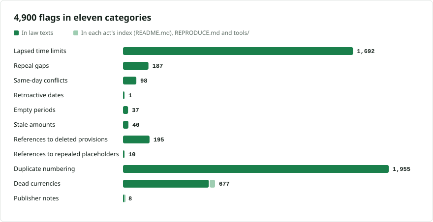

# Vulnerabilities in Brazilian law

[Português](README.md) · **English**

<picture>
<source media="(prefers-color-scheme: dark)" srcset="img/flags-by-category-dark.svg">

</picture>

The vulnerability detectors from [lexifina/global-law](https://github.com/lexifina/global-law/tree/main/vulnerabilities) look for mechanical mistakes in legislation: a rule applying "until" a date that has passed, a time limit extended only after it had run out, an amount changed in one provision but not in another, a reference to an article that has been repealed. global-law's published list (9 November 2026) covered Brazil with 203 flags from an earlier copy of this repository: 90 references to repealed placeholders, 33 repeal gaps, 20 lapsed time limits, 20 same-day conflicts, 17 references to deleted provisions, 6 duplicate numbers, 4 empty periods, 4 stale amounts, 4 failed amendments (here, publisher notes), 3 dead currencies and 2 retroactive dates. This is a run over this repository only, as it stood at commit [`88e8b73`](https://github.com/lexifina/brazil-law/commit/88e8b73cc2e3ac17be8e08fc52d59baa24f709fa) on 16 November 2026.

**In short:** the detectors raised 4,900 flags. A language model reviewed 238 of the strongest, arguing each one for and against; 44 survived. Checked by hand in this repository, two of them look like real mistakes in Brazilian law. Article 11(1) of Law 4,595/1964 still makes the controllers of a financial institution subject "to Article 44(8) of this law", but Article 71(IV) of Law 13,506/2017 repealed the whole of Article 44 from 14 November 2017, with no rule redirecting the reference to its own provisions. And the deadline for Eletrobras to sign the contracts of the first stage of Proinfa (Article 3(I)(a) of Law 10,438/2002), which Provisional Measure 181/2004 had moved to 31 May 2004, was extended to 30 June only by the conversion law, Law 10,889/2004, published and in force on 28 June with no retroactive wording: from 1 to 27 June 2004 the deadline had passed. Three more are real gaps, but chosen rather than overlooked: the new Article 1(I) of Law 9,991/2000 (minimum shares for research and development and for energy efficiency until 2025) was vetoed and took effect only once the veto was overridden, in July 2023; the exemption from withholding on air tickets bought with the Federal Government Payment Card (Article 64(9) of Law 9,430/1996) expired in 2017, and the two provisional measures that restored it lost effect; and Law 14,288/2021 restored the one-percentage-point surcharge on Cofins-Importação (Article 8(21) of Law 10,865/2004), which had expired in 2020, only from 1 April 2022, as the Constitution requires for an increase in a social contribution (Article 195(6)). Of the other 39, 17 come from how this repository dates changes and compares texts, 11 are misreadings by a detector, 9 are lawful and 2 are spent. Reading the categories the model does not review turned up no other likely mistake; 629 flags are amounts in dead currencies (cruzeiros, cruzados, cruzados novos and cruzeiros reais), almost all in acts from before the real. Later, this will be formalised in Lean, similar to our work on [the US tax code](https://lexifina.com/blog/formalizing-the-us-tax-code) and [US case law](https://lexifina.com/blog/formalizing-all-us-case-law-in-lean).

A flag is a prompt to look, not legal advice, and nothing here has been tested in court.

## Flags by category

| Category | What it looks for | Flags | In law texts | Reviewed | Survived review |
| --- | --- | ---: | ---: | ---: | ---: |
| Lapsed time limits | Text still applying a rule "until" a date that has passed | 1,692 | 1,692 | 40 | 1 |
| Repeal gaps | A provision that had no text for a while and then came back | 187 | 187 | 40 | 5 |
| Same-day conflicts | Two acts changing the same provision on the same day | 98 | 98 | 40 | 3 |
| Retroactive or pre-publication dates | A rule in force before it was made or published | 1 | 1 | 1 | 0 |
| Empty periods | A time limit extended by an act that took effect after it had run out | 37 | 37 | 37 | 20 |
| Stale amounts | An amount changed in one provision but still standing in another | 40 | 40 | 40 | 13 |
| References to deleted provisions | A provision citing an article that no longer exists | 195 | 195 | 40 | 2 |
| References to repealed placeholders | A provision citing an article whose text is only "(Revogado)" | 10 | 10 | 0 | 0 |
| Duplicate numbering | Two units with the same number in one file | 1,955 | 1,955 | 0 | 0 |
| Dead currencies | Amounts in currencies no longer in use | 677 | 631 | 0 | 0 |
| Publisher notes | Marks such as "(sic)" and phrases that flag failed amendments in other countries | 8 | 1 | 0 | 0 |

"In law texts" counts every file in an act's folder: the Constitution, the codes, laws, complementary laws and decree-laws, with each act's preamble and headings. The other flags are in each act's `README.md`, which repeats its summary (22 amounts in dead currencies), in [`REPRODUCE.md`](../REPRODUCE.md) (24 amounts and 4 notes) and in `tools/` (3 notes). The search for lapsed time limits now also reads the first day of a month written as an ordinal ("até 1º de janeiro de 2021", "1o de março"), "31 de dezembro do ano de 2020" and "até a data de 30 de abril de 2020": 1,631 flags became 1,692. It still leaves out 71 lines with phrases that give only a year ("até o exercício de 2020", "até o ano de 2020", "até o final de 2020"). The search for dead currencies now reads the symbols of the old currencies (Cr$, Cz$, NCz$, CR$) and no longer takes the "marco" of boundary descriptions ("partindo do marco 26", from survey marker 26) for the German mark: 11 flags became 677. The reference search no longer reads "§ 2º" (a paragraph) as Article 2, or "art. 90 da Medida Provisória nº 2.158-35" as a reference to the act's own article, and reads "art. 3º-A" as Article 3-A, not Article 3: references to deleted provisions went from 269 to 195. The search for references to repealed placeholders no longer takes an article whose text is a repeal clause ("Fica revogado o § 1º...") or merely uses the word ("poderá ser reduzida ou suprimida") for a "(Revogado)" placeholder: 107 flags became 10. In this repository a repealed article either loses its file or keeps it with the text "(Revogado)", which is why there are flags in both reference categories.

*Edge cases: the 44 flags that survived the review, grouped by what they turned out to be, and what the other flags are, in [EDGE-CASES.en.md](EDGE-CASES.en.md).*

## Problems found in this repository

- **A vetoed part dated by the wrong promulgation:** the veto of Article 1(I) of Law 9,991/2000 as worded by Law 14,514/2022 ("until 31 December 2025, the minimum percentages [...] shall be 0.50%") was overridden and the vetoed part promulgated on 18 July 2023 (DOU of 19.7.2023), as the page of Law 14,514 on Planalto shows. This repository dates the change 22 May 2024 ([the change](https://github.com/lexifina/brazil-law/commit/3eaaf64326a2a8e8aa82fdadac6ccc59fac744d3)), the day of the second promulgation, which concerns Article 21 of Law 13,575/2017. Read that way, [Article 1 of Law 9,991](https://github.com/lexifina/brazil-law/blob/88e8b73cc2e3ac17be8e08fc52d59baa24f709fa/lei-de-pesquisa-e-desenvolvimento-do-setor-eletrico/art-01.md) is without paragraph I ten months longer than it was.
- **Changes first made by a provisional measure dated by the conversion law or the last reissue:** where Planalto's note names only the conversion law or the last reissue, the history does not record the provisional measure that made the change first. In [Article 3 of Law 10,438/2002](https://github.com/lexifina/brazil-law/blob/88e8b73cc2e3ac17be8e08fc52d59baa24f709fa/lei-do-proinfa-e-da-cde/art-03.md), Provisional Measure 181/2004 (12 April) moved the deadline in point a from 29 April to 31 May 2004, and Provisional Measure 220/2004 (1 October) moved the one in point g from 30 October to 28 December 2004; the history shows both changes only from Laws 10,889/2004 and 11,075/2004, of 28 June and 31 December. In [Article 2-A of Law 9,717/1998](https://github.com/lexifina/brazil-law/blob/810a45f82440da80bc2702a57f570844fb9c9d3b/lei-9717-de-1998/art-02-a.md), Provisional Measure 2,043-20 of 28 July 2000 already extended the suspension to 31 December 2001, and the history goes from "2000" to "2003" only with Provisional Measure 2,187-13 of August 2001. Three empty periods come from this.
- **Quoted text in files of its own in amending acts:** where Planalto leaves out the opening quotation mark of a quoted article, the article becomes a file of the amending act. Law 14,112/2020 has seven articles, but its folder also holds [`art-050-a.md`](https://github.com/lexifina/brazil-law/blob/88e8b73cc2e3ac17be8e08fc52d59baa24f709fa/lei-14112-de-2020/art-050-a.md), `art-006-b.md` and `art-011.md`, with the text it inserts into Law 11,101/2005 and Law 8,929/1994; Law 10,421/2002, with six articles, has [`art-392-a.md`](https://github.com/lexifina/brazil-law/blob/88e8b73cc2e3ac17be8e08fc52d59baa24f709fa/lei-10421-de-2002/art-392-a.md) (Article 392-A of the CLT) and `art-071-a.md` (Article 71-A of Law 8,213/1991). A reader of these files sees articles the act does not have.
- **Article 1,636 of the Civil Code inside the file of Article 1,635:** on Planalto the article begins "Art 1.636." (no full stop after "Art"), and the label was not recognised: [`art-1635.md`](https://github.com/lexifina/brazil-law/blob/88e8b73cc2e3ac17be8e08fc52d59baa24f709fa/codigo-civil/art-1635.md) holds both articles, there is no `art-1636.md`, and the Code's `README.md` does not list Article 1,636.

## Files

| File | What it holds |
| --- | --- |
| [data/flags.csv](data/flags.csv) | Every flag, one row per provision and issue |
| [data/reviewed.csv](data/reviewed.csv) | The 238 flags the model reviewed, with its verdict and reason |
| [data/by_category.csv](data/by_category.csv) | The counts in the table above |
| [tools/](tools/) | The scripts that made this run |

Columns: `category` and `category_pt` (the category in English and Portuguese), `detector`, `kind` (`law` or `other`), `path` (the file in this repository; for a retroactive date, the first file the act changed that day), `date` (the date the flag turns on), `reference` (the act or line involved), `summary`, `score` (the detector's ranking, 0 to 1), `review` (`artefact`, `lawful` or `candidate_defect`), `survives_rebuttal`, `review_note` (the model's reason, in English), `url` (the provision at the commit that was read, or, for a retroactive date, the commit that made the act's version on that day).

## How it was made

- **Detectors:** global-law's [vulnerabilities/scripts](https://github.com/lexifina/global-law/tree/main/vulnerabilities/scripts), run on this repository at commit `88e8b73`. The history table the detectors read was built from this repository's own commits (the act that made each change, its `In-force` date and its `Kind`). Commits of `Kind` `law`, `decree` and `publisher` (the single version of the acts held with their current text only) count as law; corrections and decisions of the Supreme Federal Court (`court`) are left out. The detectors carry the fixes global-law's scripts received in the runs on other country repositories, and the Portuguese ones above.
- **Model review:** gpt-5.4-mini, the 40 strongest flags per category; every lapsed time limit is in a law text, so the review of the 40 strongest in law texts drew the same flags as the general one. One pass says whether a flag is real, a second argues that it is not. Empty periods use global-law's own review for that category, on all 37 flags, followed by the same second pass. After the fix for references to other acts, the 5 new flags among the 40 strongest references to deleted provisions were reviewed (238 of the 243 reviews match a flag today). The model does not review references to repealed placeholders, duplicate numbering, dead currencies or publisher notes. global-law's own list used a different model.
- **Hand check:** every flag that survived was read in this repository's history and texts, and in the extending or citing act where this repository holds it. Planalto's pages (through Internet Archive copies) of Provisional Measures 181/2004, 220/2004, 822/2018, 2,043-20/2000 and 2,187-11/2001, of Constitutional Amendment 93/2016 and of Laws 9,717/1998, 9,991/2000, 10,865/2004, 10,889/2004, 11,075/2004 and 14,514/2022 were also read. All 10 references to repealed placeholders and all 8 publisher notes were read, as were a sample of the duplicate numbers and the dead currencies by the words matched.

To report a correction, open an issue with the provision and an official source.

## Licence

The lists and notes are Lexifina's, dedicated to the public domain under CC0 1.0, like this repository's other own contributions. Quoted law text is that of the official acts published by the Presidency of the Republic (Casa Civil) on planalto.gov.br; official acts are not protected by copyright in Brazil (Law 9,610/1998, Article 8(IV)), and the quoted text does not replace the text published in the Diário Oficial da União. See [LICENSE](../LICENSE).
