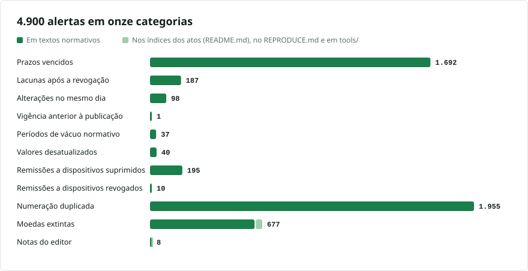

# Vulnerabilidades no direito brasileiro

**Português** · [English](README.en.md)

<picture>
<source media="(prefers-color-scheme: dark)" srcset="img/flags-by-category-dark.pt.svg">

</picture>

Os detectores de vulnerabilidades do [lexifina/global-law](https://github.com/lexifina/global-law/tree/main/vulnerabilities) procuram erros mecânicos na legislação: uma regra que continua a valer "até" uma data já passada, um prazo prorrogado quando já tinha vencido, um valor alterado num dispositivo mas não em outro, uma remissão a um artigo revogado. A lista que o global-law publicou em 9 de novembro de 2026 incluía o Brasil com 203 alertas, obtidos de uma cópia anterior deste repositório: 90 remissões a dispositivos revogados, 33 lacunas após a revogação, 20 prazos vencidos, 20 alterações no mesmo dia, 17 remissões a dispositivos suprimidos, 6 numerações duplicadas, 4 períodos de vácuo normativo, 4 valores desatualizados, 4 alterações inexequíveis (aqui, notas do editor), 3 moedas extintas e 2 datas retroativas. Esta é uma revisão deste repositório apenas, no estado do commit [`88e8b73`](https://github.com/lexifina/brazil-law/commit/88e8b73cc2e3ac17be8e08fc52d59baa24f709fa) de 16 de novembro de 2026.

**Em resumo:** os detectores geraram 4.900 alertas. Um modelo de linguagem revisou os 238 mais fortes, com argumentos a favor e contra cada um; 44 resistiram. Verificados à mão neste repositório, dois deles parecem erros reais do direito brasileiro. O art. 11, § 1º, da Lei 4.595/1964 ainda sujeita os controladores de instituição financeira "ao disposto no artigo 44, § 8º, desta lei", mas o art. 71, IV, da Lei 13.506/2017 revogou todo o art. 44 a partir de 14 de novembro de 2017, sem regra que transfira a remissão para os seus próprios dispositivos. E o prazo para a Eletrobras celebrar os contratos da primeira etapa do Proinfa (art. 3º, I, a, da Lei 10.438/2002), que a Medida Provisória 181/2004 levara a 31 de maio de 2004, só foi estendido a 30 de junho pela lei de conversão, a Lei 10.889/2004, publicada em 28 de junho e em vigor nessa data, sem efeito retroativo: de 1º a 27 de junho de 2004, o prazo estava vencido. Outros três são lacunas reais, mas deliberadas: o novo art. 1º, I, da Lei 9.991/2000 (percentuais mínimos de pesquisa e desenvolvimento e de eficiência energética até 2025) foi vetado, e só vigorou depois de derrubado o veto, em julho de 2023; a dispensa de retenção na compra de passagens aéreas com o Cartão de Pagamento do Governo Federal (art. 64, § 9º, da Lei 9.430/1996) venceu em 2017, e as duas medidas provisórias que a restabeleceram perderam a eficácia; e a Lei 14.288/2021 restabeleceu o adicional de um ponto percentual da Cofins-Importação (art. 8º, § 21, da Lei 10.865/2004), vencido em 2020, só a partir de 1º de abril de 2022, como a Constituição exige para a majoração de contribuições sociais (art. 195, § 6º). Dos outros 39, 17 se explicam pela forma como este repositório data as alterações e compara os textos, 11 são leituras equivocadas de um detector, 9 são conformes ao direito e 2 são regras exauridas. Nas categorias que o modelo não revisa, a leitura não revelou outro erro provável; 629 alertas são valores em moedas extintas (cruzeiros, cruzados, cruzados novos e cruzeiros reais), quase todos em atos anteriores ao real. Mais adiante, isto será formalizado em Lean, como o nosso trabalho sobre [o código tributário dos EUA](https://lexifina.com/blog/formalizing-the-us-tax-code) e [a jurisprudência dos EUA](https://lexifina.com/blog/formalizing-all-us-case-law-in-lean).

Um alerta é um convite a examinar o texto, não uma orientação jurídica, e nada do que aqui se expõe foi submetido a um tribunal.

## Alertas por categoria

| Categoria | O que procura | Alertas | Em textos normativos | Revisados | Resistiram à revisão |
| --- | --- | ---: | ---: | ---: | ---: |
| Prazos vencidos | Um texto que ainda aplica uma regra "até" uma data já passada | 1.692 | 1.692 | 40 | 1 |
| Lacunas após a revogação | Um dispositivo que ficou sem texto durante um período e depois voltou | 187 | 187 | 40 | 5 |
| Alterações no mesmo dia | Dois atos que alteram o mesmo dispositivo no mesmo dia | 98 | 98 | 40 | 3 |
| Vigência anterior à publicação | Uma regra em vigor antes de ser editada ou publicada | 1 | 1 | 1 | 0 |
| Períodos de vácuo normativo | Um prazo prorrogado por um ato que entrou em vigor quando ele já tinha vencido | 37 | 37 | 37 | 20 |
| Valores desatualizados | Um valor alterado num dispositivo que continua a figurar em outro | 40 | 40 | 40 | 13 |
| Remissões a dispositivos suprimidos | Um dispositivo que remete a um artigo que já não existe | 195 | 195 | 40 | 2 |
| Remissões a dispositivos revogados | Um dispositivo que remete a um artigo cujo texto é só "(Revogado)" | 10 | 10 | 0 | 0 |
| Numeração duplicada | Duas divisões com o mesmo número num mesmo arquivo | 1.955 | 1.955 | 0 | 0 |
| Moedas extintas | Valores em moedas que já não circulam | 677 | 631 | 0 | 0 |
| Notas do editor | Marcas como "(sic)" e frases que noutros países assinalam alterações inexequíveis | 8 | 1 | 0 | 0 |

"Em textos normativos" conta todos os arquivos das pastas dos atos: a Constituição, os códigos, as leis, as leis complementares e os decretos-leis, com o preâmbulo e os títulos de cada ato. Os demais alertas estão no `README.md` de cada ato, que repete a ementa (22 valores em moedas extintas), no [`REPRODUCE.md`](../REPRODUCE.md) (24 valores e 4 notas) e em `tools/` (3 notas). A busca de prazos vencidos lê agora também o primeiro dia do mês escrito como ordinal ("até 1º de janeiro de 2021", "1o de março"), "31 de dezembro do ano de 2020" e "até a data de 30 de abril de 2020": os 1.631 alertas passaram a 1.692. Continua sem ler 71 linhas com expressões que indicam só o ano ("até o exercício de 2020", "até o ano de 2020", "até o final de 2020"). A busca de moedas extintas lê agora os símbolos das moedas antigas (Cr$, Cz$, NCz$, CR$) e já não toma por marco alemão o "marco" das descrições de perímetros ("partindo do marco 26"): os alertas passaram de 11 a 677. A busca de remissões já não lê "§ 2º" como art. 2º, nem "art. 90 da Medida Provisória nº 2.158-35" como remissão ao próprio ato, e lê "art. 3º-A" como art. 3º-A, e não como art. 3º: as remissões a dispositivos suprimidos passaram de 269 a 195. A busca de remissões a dispositivos revogados já não toma por "(Revogado)" um artigo cujo texto é uma cláusula revogatória ("Fica revogado o § 1º...") ou que apenas usa a palavra ("poderá ser reduzida ou suprimida"): os alertas passaram de 107 a 10. Neste repositório, um artigo revogado ora perde o seu arquivo, ora o conserva com o texto "(Revogado)"; por isso há alertas nas duas categorias de remissões.

*Casos-limite: os 44 alertas que resistiram à revisão, agrupados segundo o que se revelaram, e o que são os demais alertas, em [EDGE-CASES.md](EDGE-CASES.md).*

## Problemas encontrados neste repositório

- **Parte vetada datada pela promulgação errada:** o veto ao art. 1º, I, da Lei 9.991/2000, na redação da Lei 14.514/2022 ("até 31 de dezembro de 2025, os percentuais mínimos [...] serão de 0,50%"), foi derrubado e a parte vetada promulgada em 18 de julho de 2023 (DOU de 19.7.2023), como mostra a página da Lei 14.514 no Planalto. Este repositório data a alteração em 22 de maio de 2024 ([a alteração](https://github.com/lexifina/brazil-law/commit/3eaaf64326a2a8e8aa82fdadac6ccc59fac744d3)), dia da segunda promulgação, que trata do art. 21 da Lei 13.575/2017. Lido assim, o [art. 1º da Lei 9.991](https://github.com/lexifina/brazil-law/blob/88e8b73cc2e3ac17be8e08fc52d59baa24f709fa/lei-de-pesquisa-e-desenvolvimento-do-setor-eletrico/art-01.md) fica sem o inciso I por dez meses a mais do que ficou.
- **Alterações feitas primeiro por medida provisória datadas pela lei de conversão ou pela última reedição:** quando a nota do Planalto cita só a lei de conversão ou a última reedição, o histórico não registra a medida provisória que fez a alteração antes. No [art. 3º da Lei 10.438/2002](https://github.com/lexifina/brazil-law/blob/88e8b73cc2e3ac17be8e08fc52d59baa24f709fa/lei-do-proinfa-e-da-cde/art-03.md), a Medida Provisória 181/2004 (12 de abril) levou o prazo da alínea a de 29 de abril a 31 de maio de 2004, e a Medida Provisória 220/2004 (1º de outubro) levou o da alínea g de 30 de outubro a 28 de dezembro de 2004; o histórico mostra as duas alterações só a partir das Leis 10.889/2004 e 11.075/2004, de 28 de junho e 31 de dezembro. No [art. 2º-A da Lei 9.717/1998](https://github.com/lexifina/brazil-law/blob/810a45f82440da80bc2702a57f570844fb9c9d3b/lei-9717-de-1998/art-02-a.md), a Medida Provisória 2.043-20, de 28 de julho de 2000, já estendia a suspensão até 31 de dezembro de 2001, e o histórico passa de "2000" a "2003" só com a Medida Provisória 2.187-13, de agosto de 2001. Três períodos de vácuo normativo resultam disso.
- **Texto citado em arquivos próprios nos atos alteradores:** quando o Planalto omite as aspas de abertura de um artigo citado, o artigo vira um arquivo do ato alterador. A Lei 14.112/2020 tem sete artigos, mas a sua pasta tem também [`art-050-a.md`](https://github.com/lexifina/brazil-law/blob/88e8b73cc2e3ac17be8e08fc52d59baa24f709fa/lei-14112-de-2020/art-050-a.md), `art-006-b.md` e `art-011.md`, com o texto que ela insere na Lei 11.101/2005 e na Lei 8.929/1994; a Lei 10.421/2002, com seis artigos, tem [`art-392-a.md`](https://github.com/lexifina/brazil-law/blob/88e8b73cc2e3ac17be8e08fc52d59baa24f709fa/lei-10421-de-2002/art-392-a.md) (o art. 392-A da CLT) e `art-071-a.md` (o art. 71-A da Lei 8.213/1991). Quem lê esses arquivos vê artigos que o ato não tem.
- **Art. 1.636 do Código Civil dentro do arquivo do art. 1.635:** no Planalto o artigo começa com "Art 1.636." (sem ponto depois de "Art"), e o rótulo não foi reconhecido: o [`art-1635.md`](https://github.com/lexifina/brazil-law/blob/88e8b73cc2e3ac17be8e08fc52d59baa24f709fa/codigo-civil/art-1635.md) contém os dois artigos, não há `art-1636.md`, e o `README.md` do Código não lista o art. 1.636.

## Arquivos

| Arquivo | Conteúdo |
| --- | --- |
| [data/flags.csv](data/flags.csv) | Todos os alertas, uma linha por dispositivo e problema |
| [data/reviewed.csv](data/reviewed.csv) | Os 238 alertas que o modelo revisou, com o veredito e o motivo |
| [data/by_category.csv](data/by_category.csv) | Os números da tabela acima |
| [tools/](tools/) | Os scripts desta revisão |

Colunas: `category` e `category_pt` (a categoria em inglês e em português), `detector`, `kind` (`law` ou `other`), `path` (o arquivo neste repositório; na vigência anterior à publicação, o primeiro arquivo que o ato alterou nesse dia), `date` (a data de que depende o alerta), `reference` (o ato ou a linha em causa), `summary`, `score` (a pontuação do detector, de 0 a 1), `review` (`artefact`, `lawful` ou `candidate_defect`), `survives_rebuttal`, `review_note` (o motivo do modelo, em inglês), `url` (o dispositivo no commit lido ou, na vigência anterior à publicação, o commit que deu ao ato a sua versão desse dia).

## Como foi feito

- **Detectores:** os [vulnerabilities/scripts](https://github.com/lexifina/global-law/tree/main/vulnerabilities/scripts) do global-law, executados neste repositório no commit `88e8b73`. A tabela de histórico que os detectores leem foi construída com os próprios commits deste repositório (o ato que fez cada alteração, a data `In-force` e o `Kind`). Contam como direito os commits de `Kind` `law`, `decree` e `publisher` (a versão única dos atos que só têm o texto atual); ficam de fora as correções e as decisões do STF (`court`). Os detectores incorporam as correções que os scripts do global-law receberam nas revisões de outros repositórios nacionais e as do português indicadas acima.
- **Revisão pelo modelo:** gpt-5.4-mini, os 40 alertas mais fortes de cada categoria; todos os prazos vencidos estão em textos normativos, de modo que a revisão dos 40 mais fortes em textos normativos coincidiu com a geral. Uma passada diz se o alerta é real e outra argumenta que não é. Os períodos de vácuo normativo usam a revisão própria do global-law para essa categoria, sobre todos os 37 alertas, seguida da mesma segunda passada. Depois da correção das remissões a outros atos, os 5 alertas novos entre as 40 remissões a dispositivos suprimidos mais fortes foram revisados (das 243 revisões, 238 correspondem a alertas atuais). O modelo não revisa as remissões a dispositivos revogados, a numeração duplicada, as moedas extintas nem as notas do editor. A lista própria do global-law usou outro modelo.
- **Verificação manual:** cada alerta que resistiu foi lido no histórico e nos textos deste repositório, e no ato que prorroga ou remete quando o repositório o contém. Foram lidas também, nas páginas do Planalto (por cópias do Internet Archive), as Medidas Provisórias 181/2004, 220/2004, 822/2018, 2.043-20/2000 e 2.187-11/2001, a Emenda Constitucional 93/2016 e as Leis 9.717/1998, 9.991/2000, 10.865/2004, 10.889/2004, 11.075/2004 e 14.514/2022. Foram lidas as 10 remissões a dispositivos revogados, as 8 notas do editor, uma amostra da numeração duplicada e, pelas palavras encontradas, as moedas extintas.

Para comunicar uma correção, abra uma issue com o dispositivo e uma fonte oficial.

## Licença

As listas e as notas são da Lexifina e estão dedicadas ao domínio público sob CC0 1.0, como as demais contribuições próprias deste repositório. O texto legal citado é o dos atos oficiais publicados pela Presidência da República (Casa Civil) em planalto.gov.br; os atos oficiais não são protegidos por direito autoral no Brasil (Lei 9.610/1998, art. 8º, IV), e o texto citado não substitui o publicado no Diário Oficial da União. Veja [LICENSE](../LICENSE).
